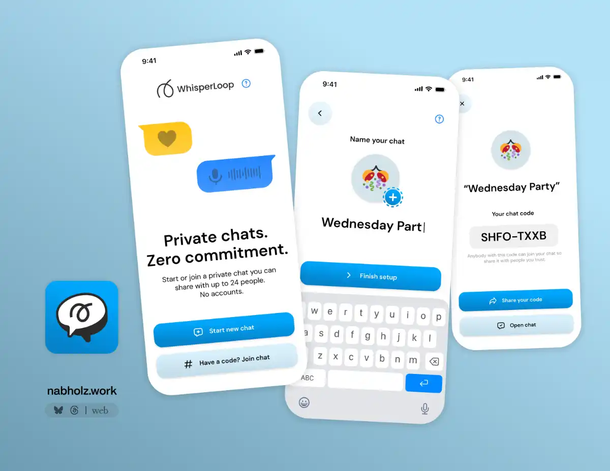
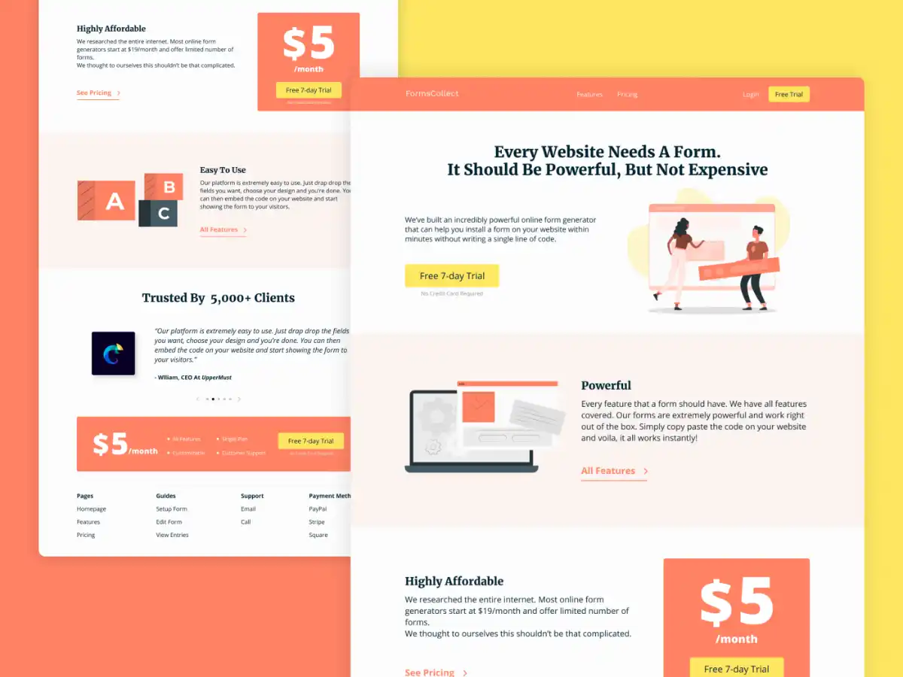
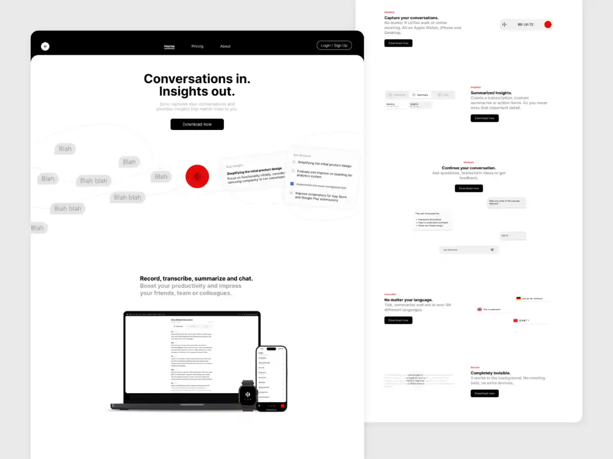
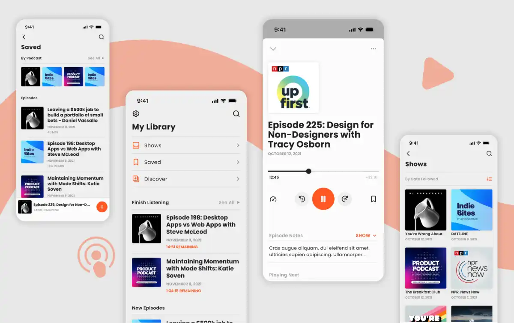
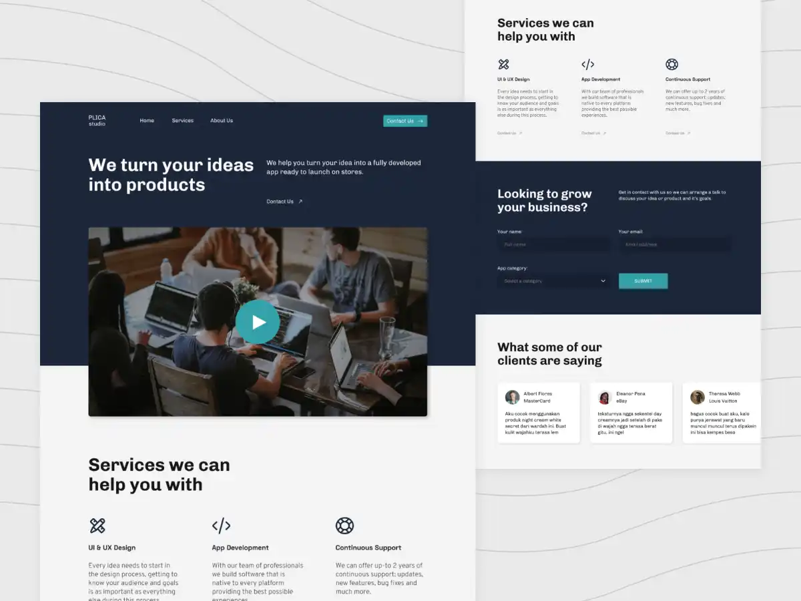

A selection of websites and apps I’ve designed for clients over the past few years.

## WhisperLoop App

WhisperLoop is a self-destructing chat application, it is designed with the core idea of having one-off private chats with anybody, it allows creating groups and simply sharing a private code other people can use to join your temporary chat.

## FormsCollect Website

A complete redesign of the FormsCollect website, with custom illustrations and an entierly different brand direction.

## Sona Website

A website showcasing the features and design of 'Sona', a productivity tool that helps you record and transcribe calls, conferences, and anything in between.

## Lig Podcast App

A podcast app desgined from the ground-up to help users consistently finish episodes from their favorite podcasts.

## Plica Website

Marketing agency 'Plica' landing site

